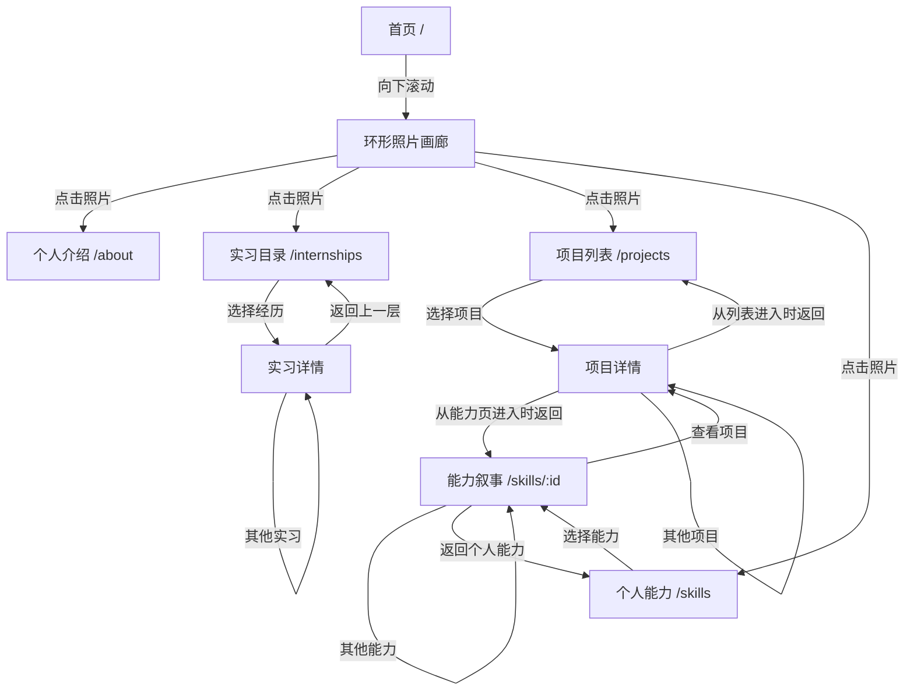

# AI 产品作品集（匿名公开版）

在线网站：[Netlify 作品集](https://stephenwu-portfolio.netlify.app/)

本仓库是供查看实现方式的**脱敏公开版源码**；Netlify 网站保留完整内容，两者不作为相同版本同步发布。公开源码中的姓名、学校、雇主、合作品牌和业务指标已作匿名处理，原始业务截图不放入仓库。

## 页面节点与主路径



顶栏可以直接进入个人介绍、实习目录、项目列表和个人能力；左侧站点标题返回首页。实习和项目详情是在目录页上展开的内容层，不是独立路由。

| 节点 | 进入与流转 | 返回或继续 |
| --- | --- | --- |
| 首页 `/` | 先显示个人概括与背景视频；向下滚动后，概括淡出，环形画廊出现。滚动或拖动可改变照片位置。 | 点击照片进入四个一级栏目。 |
| 个人介绍 `/about` | 从第一站静帧开始；点击热点或文字按钮展开内容；点击“开始探索/继续探索”播放本站离开视频。**视频播完**才停在下一站。 | 顶部进度可返回已到过的站；末站可进入其他栏目。 |
| 实习目录 `/internships` | 滚动、拖动或方向键切换唱片；选择经历后展开详情。有效的 `?work=` 参数可直达对应详情。 | 详情底部返回目录或切换其他实习。 |
| 项目列表 `/projects` | 滚动或使用页面控件切换聚焦项目，也可切换呈现方式。点击未聚焦封面先聚焦，再打开详情；有效的 `?work=` 参数可直达详情。 | 详情底部返回列表或切换其他项目。 |
| 个人能力 `/skills` | 拼贴图先显示封面，视频就绪后显示视频；点击能力按钮进入能力叙事。 | 能力页可回拼贴入口或进入其他能力。 |
| 能力叙事 `/skills/:id` | 滚动展示相关项目证据；点击有目标详情的“查看项目”进入项目详情。 | 从能力页进入的项目详情关闭后返回原能力页及原项目位置。 |

## 栏目内部如何流转

### 个人介绍：静帧 → 阅读 → 过场视频 → 下一站

顺序为：创意街区 → 独立书店 → 城市路口 → 图书馆 → 游戏与购物街区 → 江边步道。每站先停在静帧，热点只负责展开或收起文字；“展开了解”会展开该站全部热点。离开按钮才启动视频。视频播放完成后进入下一站，加载或播放失败时退到下一站静帧。末站没有后续过场视频。声音默认关闭，可手动切换。

### 实习目录：选择经历 → 阅读详情 → 返回/切换

| 匿名节点 | 直达地址 | 内容方向 |
| --- | --- | --- |
| 建材企业 A | `/internships?work=building` | 海外市场与展会传播 |
| 内容科技企业 B | `/internships?work=contentagency` | 品牌内容与海外获客 |
| 工业设备企业 C | `/internships?work=machinery` | 海外展会与客户沟通 |
| 教育机构 D | `/internships?work=education` | 校园市场与咨询反馈 |

目录选中经历后，地址栏写入对应 `work`，详情展示工作背景、产出与工作方式。页尾可切换其他经历；关闭详情时回到目录。若详情由能力页进入，优先回到原能力节点。

### 项目列表：聚焦封面 → 展开案例 → 返回/下一案例

| 匿名节点 | 直达地址 | 案例主题 |
| --- | --- | --- |
| 酒饮品牌 | `/projects?work=beverage` | 市场证据与方向判断 |
| 消费电子品牌 | `/projects?work=device` | 智能售后 Agent |
| 美妆品牌 | `/projects?work=beauty` | 服务决策与人工接管 |
| HR 招聘 | `/projects?work=hr` | 证据约束的候选人评估 |
| 海外压缩沙发 | `/projects?work=sofa` | 海外内容与用户顾虑 |
| AI 穿搭实验 | `/projects?work=muse` | 视觉内容与选题实验 |
| PlanFlow | `/projects?work=planflow` | 任务规划与执行流程 |

案例从项目背景/问题进入，再展示机制、验证边界与个人工作。详情底部的卡片可选择其他项目：点击非最前面的卡片先将它移到前面，再点击打开。关闭详情回到项目列表；从能力页进入时，返回原能力页和原位置。

### 个人能力：选择能力 → 滚动证据 → 查看项目

| 能力入口 | 直达地址 |
| --- | --- |
| 商业洞察 | `/skills/insight` |
| 产品策略 | `/skills/strategy` |
| AI 产品设计 | `/skills/ai` |
| 增长运营 | `/skills/growth` |
| 项目推进 | `/skills/delivery` |

能力页先给出该能力的判断，再通过滚动展示关联项目。带“查看项目”按钮的证据进入 `/projects?work=<项目 ID>`；没有对应详情的证据只作展示，不生成空链接。页尾可进入其他能力或返回拼贴入口。

## 动态与回退

- 首页背景视频有静态封面；个人能力拼贴视频有封面，视频可播放后才显示视频层。
- 系统开启“减少动态效果”时，能力拼贴保留静态封面，项目列表改为可直接选择的网格，能力证据直接呈现为静态阅读内容。
- 页面按路由加载代码；项目详情在需要时加载，鼠标悬停或键盘聚焦时预加载。

## 源码入口

| 想核对的流转 | 对应文件 |
| --- | --- |
| 路由与按需加载 | `src/App.tsx`、`src/routeLoaders.ts` |
| 首页入口与项目索引 | `src/pages/Home.tsx`、`src/content.ts` |
| 个人介绍站点、视频与热点 | `src/about/story.ts`、`src/pages/About.tsx` |
| 实习目录与详情切换 | `src/pages/Internships.tsx` |
| 项目列表与详情切换 | `src/pages/Projects.tsx`、`src/components/DetailEnd.tsx` |
| 个人能力及项目回跳 | `src/pages/Skills.tsx`、`src/pages/Capability.tsx`、`src/pages/capability.data.ts` |

## 本地运行

```sh
npm ci
npm run build
npm run dev
```

构建产物为 `dist/`。本仓库的推送**不会自动更新**上方 Netlify 完整作品集；发布前需单独确认展示内容与权限。不要将客户截图、联系方式、内部资料或可追溯的业务指标加入公开仓库。
